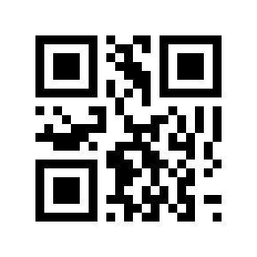

# Pairing a board to a Zigbee network

## How a board joins

The board is a Zigbee end device. It joins any Zigbee network whose coordinator admits it: the coordinator opens
a pairing window (often called "permit join"), and the board, which is looking, joins during it.

- **A board that is not on a network looks by itself.** It tries to join every 10 seconds for 15 minutes after
  power-up (or after `POST /api/v1/zigbee/pair`), and then every 60 seconds, until it joins. Several tries inside
  one window are normal: in testing a join took from 6 to 56 tries.
- **A board that is on a network does not look.** `POST /api/v1/zigbee/pair` on a joined board answers
  `409 already_joined`. To move a board to another network, erase its Zigbee state with
  `POST /api/v1/zigbee/erase`: that keeps the claim and the settings, and the board starts looking again.
- **Where the board joins is not limited by default.** The `ext_pan` setting restricts it to one extended PAN
  ID, which is useful where several networks are in range.
- **The coordinator shows a new device only while joining is open.** If the board does not appear, check that the
  window is still open, and that the board is powered and on a channel the coordinator uses.

## Install code or default link key

A Zigbee 3.0 device joins in one of two ways. With the **default link key** it uses the well-known key every
Zigbee 3.0 coordinator accepts for joining, and the coordinator then sends a fresh network key. With an
**install code** it uses a key derived from a code unique to the device, which the coordinator must have been
given first.

Zigbee Anthema joins with the **default link key**. The build option `C6_ZB_INSTALL_CODE` (the 128-bit code plus its
CRC, 36 hex digits) can be set at build time for a coordinator that requires one; the default build has none, so
a coordinator that insists on install codes will not admit it.

## Two identity profiles

What the board tells the coordinator about itself is its identity.

| Profile | What the coordinator sees | When to use it |
|---|---|---|
| **neutral** (the default) | manufacturer `"Zigbee Anthema"`, model `"zigbee-anthema"`, Espressif's manufacturer code `0x131B`, the chip's own IEEE address, a colour light | any coordinator that does not insist on a particular bulb |
| **Sengled E11-N1EA** (build option `C6_ZB_PROFILE_SENGLED_E11`) | the names, address range and clusters of that bulb | a Zigbee controller that admits only that bulb |

`docs/adapting.md` has the build options. A board that has been paired keeps the identity it was paired with;
changing the profile, the names or the address afterwards means removing the board from the coordinator and
pairing it again.

## One board alone in its group

If your Zigbee controller groups bulbs, keep a board **alone in its group**. In testing, with two bulbs in a group
Kohler Anthem+ ignored every bulb's reports, so its touchscreen drifted from the real lights. Alone in a group, a board's
reports are followed.

## Worked example: Kohler Anthem+

This is the system the board was built for and tested on. Its web page adds a light like this.

1. In Kohler Anthem+'s web page, choose to add a light. It asks for a **QR code** to start the scan. It does not read the
   content: **any QR code starts the scan.** This repository has one, for every board:

   

   The text in it is:

   ```
   ZigbeeAnthema
   ```

   For a reader without a camera, or to make it again, the one-line command that made the image is:

   ```sh
   python3 -c "import qrcode; qrcode.make('ZigbeeAnthema').save('docs/images/pairing-qr.png')"
   ```

   (It needs the `qrcode` package with Pillow.) Show the image on a screen and scan it in the web UI.

2. Kohler Anthem+ opens joining to every device and **lists every new device that joins** in that window. So **pair one
   board at a time**, and keep any other new Zigbee device out of range or off until it is done.

3. Power the board (or restart it, or `POST /api/v1/zigbee/pair` if it is already on Wi-Fi). It joins after some tries (see above) and Kohler Anthem+ lists it. Save it into a group. The board learns which group from Kohler Anthem+'s own message
   and reports it as `zigbee.group`.

4. **Colour or brightness only follows the `hue` setting**, and Kohler Anthem+ reads that setting only at a pairing.
   After the join it asks every bulb it has for its hue. A board with `hue` on (the default) answers with a
   value, and it offers colour and brightness. A board with `hue` off answers that the attribute is not
   supported, and it offers brightness only. It reads the answer **only when it pairs a bulb**: a
   re-pair of this board, or the pairing of any other bulb. Changing `hue` takes effect on the board at its next
   reboot or `POST /api/v1/zigbee/erase`, and reaches Kohler Anthem+ at the next pairing after that, never at once.

5. **Keep the board alone in its group.** See above; in Kohler Anthem+'s web page, a group with two bulbs is where it goes
   wrong.

**What to expect afterwards.** When the board reports a light as On, the Kohler Anthem+ touchscreen shows it only after a
hold of about 12 to 19 seconds. A reported Off shows within 1 to 3 seconds. That is Kohler Anthem+, not the board,
and a client that mirrors a light should not expect an instant On on its tile.
